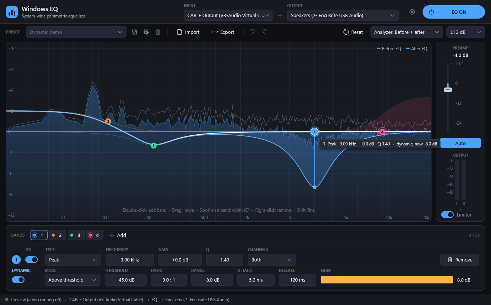

# Windows EQ

A system-wide parametric equalizer for Windows. It EQs **everything** you hear
(music, video, games, calls) with studio-quality filters, a live spectrum
analyzer and one-click A/B comparison. It is light on CPU and needs no admin
rights to install.



## Features

- **Up to 32 bands:** peak, low/high shelf, low/high pass, band pass, notch
  and all pass. Each band can apply to both channels, the left only or the
  right only.
- **Dynamic EQ:** a peak or shelf band can react to the music. For example,
  it can cut harsh highs or sibilance only when they get loud, or lift the
  bass only when it's quiet. You set threshold, ratio, range, attack and
  release, and see the band move live.
- **Interactive graph:** drag bands with the mouse, scroll to change their
  width, and see each band's curve and the combined curve.
- **Live spectrum analyzer:** shows your audio **before and after** the EQ.
- **EQ ON / BYPASSED switch** (or press `B`) for instant A/B comparison.
- **Presets:**
  - built-in presets, plus your own;
  - **import AutoEQ** headphone corrections (`ParametricEQ.txt`) or
    Equalizer APO configs, and export them back;
  - undo and redo.
- **No clipping:** an **Auto preamp**, a safety limiter and output meters.
- **Runs in the tray:** closing the window keeps the EQ running. It can
  start with Windows.
- **High quality, light on CPU and GPU:**
  - 64-bit filter maths;
  - click-free parameter changes;
  - a bit-exact passthrough when the EQ is flat;
  - about 2% of one CPU core in total;
  - a few percent of the GPU while the window is visible, and nothing at
    all while it's hidden, covered or minimized.

## Requirements

- **Windows:** Windows 10 version 1703 or later, or Windows 11, 64-bit.
- **[VB-Cable](https://vb-audio.com/Cable/)**, the free virtual audio cable
  from VB-Audio. Windows EQ receives your audio through it (see
  [How it works](#how-it-works)).

## Install

1. **Install VB-Cable:** download it from
   [vb-audio.com/Cable](https://vb-audio.com/Cable/), extract it, then
   right-click `VBCABLE_Setup_x64.exe` and choose **Run as administrator**.
   Reboot if it asks.
2. **Install Windows EQ:** download `WindowsEQ-Setup.exe` from the
   [latest release](../../releases/latest) and run it.
   - It installs for your account only (no admin prompt).
   - Leave **Start Windows EQ when I sign in** ticked if you want the EQ on
     all the time.
3. **Send Windows audio through the EQ:** click the speaker icon in the
   taskbar and choose **CABLE Input** as the output. If you forget, Windows
   EQ shows a banner with a button that opens Sound settings.
4. **Choose your real speakers or headphones** in Windows EQ's **OUTPUT**
   box at the top.

**SmartScreen warning:** the installer isn't code-signed, so Windows may say
"Windows protected your PC". Click **More info → Run anyway**.

## Using it

| Do this | To |
|---|---|
| Double-click the graph | Add a band there |
| Drag a band | Change its frequency and gain |
| Scroll on a band | Change its width (Q) |
| Right-click a band | Remove it |
| Hold **Shift** while dragging or scrolling | Fine adjustment |
| Double-click a band | Reset its gain to 0 dB |
| Drag, scroll or click a number field | Edit it (typing `1.5k` works) |
| `B` | EQ on / bypassed |
| `Ctrl+Z` / `Ctrl+Y` | Undo / redo |
| `Delete` | Remove the selected band |
| `F12` | Show frame timings |

### Dynamic EQ

Select a peak or shelf band and switch **DYNAMIC** on in the band editor. The
band's gain then moves with the level of the music in that band's range.

| Setting | What it does |
|---|---|
| **Mode** | *Above threshold*: act when this band gets loud (tame, de-ess). *Below threshold*: act when it's quiet (lift) |
| **Threshold** | The level (dBFS) in the band's range where the dynamics start |
| **Ratio** | How strongly the gain follows the level past the threshold (2:1 gentle, 10:1 hard) |
| **Range** | The most the gain can move: −8 dB cuts up to 8 dB, +6 dB boosts up to 6 dB |
| **Attack / Release** | How fast it reacts, and how fast it recovers |

**On the graph:**
- a shaded area shows how far the band can move;
- a small marker and a bright curve show what it's doing right now;
- the **NOW** meter in the editor shows the live gain change.

Good starting points:
- the built-in **De-esser (dynamic)**;
- **Tame harshness (dynamic)**;
- **Dynamic loudness**, which lifts bass and treble only while they're quiet.

Dynamic settings are saved in preset files as `# WindowsEQ Dynamic …` comment
lines, which Equalizer APO and other tools ignore.

Tips:

- **Use a measured correction:** for headphones, find your model on
  [AutoEQ](https://autoeq.app), download its `ParametricEQ.txt`, click
  **Import**, then **Save as** to keep it as a preset.
- **To hear the EQ working,** pick **Built-in · Telephone (test)** and
  press `B` a few times.
- **Avoid clipping:** if the **Auto** button under the preamp turns blue,
  your boosts could clip. Click it.
- **The tray:** closing the window hides Windows EQ there. Click the icon to
  open it; right-click it for EQ on/off, presets, Start with Windows and
  **Quit**. The icon turns amber while the EQ is bypassed.

Your settings live in `%APPDATA%\WindowsEQ`:

- `eq.txt` is the current EQ, in Equalizer APO format; editing it in a text
  editor works too;
- `presets\` holds your saved presets.

## Limitations

- **Latency:** Windows EQ adds about **50 ms**. That's unnoticeable for music
  and video, but you may notice it when monitoring yourself live or in
  fast-paced games.
- **Keep it running:** while Windows plays to CABLE Input, you hear nothing
  unless Windows EQ is running. Quit asks you first; use the tray, or turn on
  Start with Windows.
- **Some apps aren't EQ'd:** apps that bypass the Windows default output
  (DAWs using ASIO, apps in exclusive mode, programs set to a specific device)
  don't go through VB-Cable.
- **Tested hardware:** so far it has been tested on a Focusrite USB interface
  and HDMI output. The routing adapts to each device's timing, but please
  report problems; the status bar's Latency / Drift / Dropouts numbers help.

## Troubleshooting

- **No sound:**
  - Windows EQ must be running while Windows plays to CABLE Input.
  - Check that the status bar says **Running**, and that the **OUTPUT** box
    shows your real device.
- **The EQ has no effect:** if the yellow banner says Windows isn't playing
  to CABLE Input, click **Open Sound settings** and choose CABLE Input.
- **Crackles or dropouts:** the status bar's **Dropouts** counter shows
  whether audio is being interrupted. The buffer grows by itself after a
  dropout.
- **The app closed unexpectedly:** it writes a report to
  `%APPDATA%\WindowsEQ\crashes\` (`crash.log` plus a `.dmp` file).
  Non-fatal errors go to `%APPDATA%\WindowsEQ\error.log`. Please attach both
  to a bug report. Each release includes `WindowsEQ.pdb` for reading the
  dumps.

## Uninstall

Use **Settings → Apps → Windows EQ → Uninstall**, or the gear menu in the
app. It removes the app, its shortcut and its sign-in launch. It deletes your
presets only if you tick the box.

Afterwards, set your speakers or headphones as the Windows output again.
VB-Cable stays installed; remove it with its own setup if you no longer
need it.

## How it works

```
apps ──► CABLE Input (Windows default) ══VB-Cable══► CABLE Output ──► Windows EQ ──► your speakers
```

Windows offers apps no supported way to process all audio on every device.
Windows EQ therefore receives the audio from a virtual cable, equalizes it,
and plays it on your real device.

An adaptive resampler keeps the two device clocks in step without audible
pitch changes. The routing also handles drivers that stall or deliver audio
irregularly.

[docs/ARCHITECTURE.md](docs/ARCHITECTURE.md) covers the DSP, the router, the
app, the installer and the experimental APO in detail.

## Building from source

You need **Visual Studio** with the *Desktop development with C++* workload
(built and tested with Visual Studio 2026), and **CMake 3.20+**. There are no
other dependencies.

```bash
cmake -S . -B build -G "Visual Studio 18 2026" -A x64
cmake --build build --config Release
```

Visual Studio 2022 (`-G "Visual Studio 17 2022"`) should work but hasn't been
tested.

Outputs:

| File | What |
|---|---|
| `build/gui/Release/WindowsEQ.exe` | The app |
| `build/installer/Release/WindowsEQ-Setup.exe` | Installer, also copied to `dist/` |
| `build/router/Release/weq-router.exe` | Command-line router (same engine, no UI) |
| `build/setup/Release/weq-setup.exe`, `build/apo/Release/WindowsEqApo.dll` | Experimental APO route |

Tests:

```bash
build/tests/Release/eqdsp_tests.exe      # DSP, resampler, drift controller, preset parser
build/tests/Release/analyzer_test.exe    # spectrum analyzer
build/tests/Release/apo_smoke.exe        # APO COM/aggregation smoke test
build/tests/Release/eqdsp_bench.exe      # DSP CPU benchmark
build/gui/Release/WindowsEQ.exe --bench bench.txt   # UI rendering benchmark (CPU and GPU)
```

Scripts in `tools/`:

| Script | What it does |
|---|---|
| `check-install.ps1` | Reports the state of an installed copy |
| `eval-resources.ps1` | Checks the running app's frame rate, GPU and CPU in five window states. Play some audio first |
| `zorder-check.ps1` | Shows which windows are above Windows EQ and whether they count as covering it |

## License

[MIT](LICENSE). VB-Cable is a separate product by VB-Audio with its own
license; it is not included in or distributed with Windows EQ.

See [CHANGELOG.md](CHANGELOG.md) for release notes.
